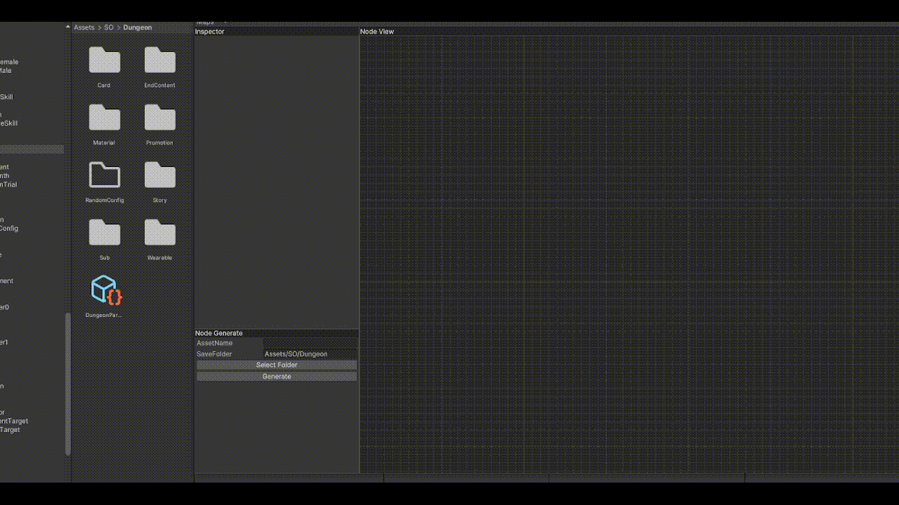

# DungeonRecord

구글 플레이 링크 : https://play.google.com/store/apps/details?id=com.HyeonStudio.GooglePlay_UpcomingReleases

## 프로젝트 소개
- 개발기간 : 2024/03 ~ 진행중
- 장르 : 턴제 던전 RPG(3D, 횡 스크롤)
- 플랫폼 : Mobile (AOS / iOS 예정)
- 도구 : Unity, C#, UniTask, Addressable, Cloud Service(뒤끝), AWS Lambda, AWS S3, Github Actions 
- 인원 : 1인

## 핵심 요약
- 1인 개발. 클라이언트 전체, 서버 펑션, 빌드·배포 파이프라인을 담당하고 Google Play 출시까지 진행
- 하이라이트
  1. [보상·결제 처리 안정성](#보상결제-처리-안정성): 요청 ID 멱등 처리, 낙관적 지급·롤백, 2단계 지급, 지급 후 Confirm
  2. [클라이언트 - 서버 검증 분리](#클라이언트---서버-검증-분리): 재화·가챠·상점 결과를 서버가 확정, 정상 플레이로 불가능한 요청은 자동 기록
  3. [테스트 가능한 전투 규칙](#테스트-가능한-전투-규칙): 판정을 순수 함수로 분리하고 난수를 주입해 경계 상황을 테스트로 고정
  4. [던전 진행 복원](#던전-진행-복원): 앱이 강제 종료돼도 전투 중간 상태(효과의 남은 턴·중첩·시전자)까지 복원

## 프로젝트 구조

어셈블리를 4계층으로 나누고 참조 방향을 한쪽으로 고정함.
계층을 넘는 참조가 컴파일 단계에서 막히므로, 순환 참조가 생기기 전에 드러남.

```
Core ──────── 확장 메서드, 싱글톤, Localize, UIMultiView (의존 없음)
  ↑
Shared ────── Enum, Interface, SO 정의, 서버 테이블 DTO
  ↑
FrameWork ─── Manager, UI(Page/Popup), BDatabase, Addressables
  ↑
GamePlay ──── Dungeon, Character, Item, Shop, Quest ... (실제 게임 로직)

ScriptsEditor ── 위 전부 참조. 에디터 툴 (Editor 플랫폼 전용)
```

```
[클라이언트 — Unity]
ContentsManager   : 모든 게임 시스템의 허브. Get<T>()로 접근
BDatabase         : 서버 CDN + Addressables 테이블 로딩
UIManager         : Page(화면) / Popup(팝업) 이중 스택
EffectExecutor    : 버프·디버프·도트 효과 실행
BattleController  : 턴 순서, 스킬 실행, 전투 진행

        ↕ BFunc 호출 / 검증된 결과 수신

[서버 — AWS Lambda + 뒤끝]
ConsumeItemFunction   : 아이템 소비 검증·차감
DungeonRewardFunction : 던전 보상 지급 (장비 랜덤 롤 포함)
CharacterGachaFunction: 가챠 확률·천장 처리
ShopFunction          : 상점 구매 검증 (인앱 결제 영수증 검증 포함)
MailReceiveFunction   : 우편 수령 (2단계 지급)
UpdateUserFunction    : 접속 시 일·주·월 리셋, 미지급 보상 지급
GrowthFunction 외 7종 : 캐릭터·무기 성장, 업적, 배틀패스, 퀘스트 보상 등
BackendSharedLib      : 공용 응답·트랜잭션·요청 멱등 처리·아이템ID 규격
```

## 코드

### 이펙트 시스템

버프·디버프·출혈·중독·기절이 전부 "효과"지만 생명주기가 서로 다름.
데미지는 즉시 끝나고, 버프는 해제 시점에 되돌려야 하고, 도트는 매 턴 실행되며 연출 대기가 필요함.

이걸 하나의 인터페이스로 묶으면 데미지 핸들러가 쓰지도 않을 해제·도트 메서드를 빈 구현으로 갖게 됨.

**1. 생명주기별로 인터페이스를 나눔**

필요한 계약만 갖도록 4종으로 분리함. 핸들러는 자기에게 해당하는 것만 구현함.
https://github.com/hyeon0316/Project-Code-Repository/blob/29228c615d3dad593a3454dcea4ae559820e910e/%EC%83%81%EC%9A%A9%20%ED%94%84%EB%A1%9C%EC%A0%9D%ED%8A%B8-DungeonRecord/Scripts/GamePlay/Effect/Handler/IEffectHandler.cs#L1-L26

| 인터페이스 | 계약 | 해당 효과 |
|---|---|---|
| `IEffectHandler` | `Execute(effect)` | 대상이 없는 효과 (스태미나 회복) |
| `ITargetEffectHandler` | `Execute(effect, context)` | 즉시 끝나는 효과 (데미지, 회복, HP 감소) |
| `IStatusEffectHandler` | `OnApply` + `OnRemove` | 붙을 때·떨어질 때 할 일이 있는 효과 (스탯 버프, 기절) |
| `IDotEffectHandler` | `IsSharedStack` + `CalcDotDamage` | 매 턴 피해를 주는 효과 (출혈, 중독) |

지속·도트 효과의 **등록·갱신·중첩은 핸들러가 아니라 대상 유닛이 한 곳에서 처리함**.
핸들러는 "처음 붙을 때와 떨어질 때 할 일", "도트 피해 공식"만 가지므로,
중첩 규칙을 바꿔도 핸들러를 고치지 않음.
https://github.com/hyeon0316/Project-Code-Repository/blob/29228c615d3dad593a3454dcea4ae559820e910e/%EC%83%81%EC%9A%A9%20%ED%94%84%EB%A1%9C%EC%A0%9D%ED%8A%B8-DungeonRecord/Scripts/GamePlay/Effect/EffectExecutor.cs#L47-L53

**2. 스탯 버프 핸들러를 enum에서 자동 등록**

버프·디버프는 대상 스탯만 다르고 처리가 같음. 13종을 각각 등록하면 스탯이 늘 때마다 등록도 늘어남.
`EffectType`을 순회하면서 스탯 매핑이 있는 것만 같은 핸들러 인스턴스에 연결함.
https://github.com/hyeon0316/Project-Code-Repository/blob/29228c615d3dad593a3454dcea4ae559820e910e/%EC%83%81%EC%9A%A9%20%ED%94%84%EB%A1%9C%EC%A0%9D%ED%8A%B8-DungeonRecord/Scripts/GamePlay/Effect/EffectExecutor.cs#L24-L39

`EffectTypeExtension`의 `STAT_MAP`에 한 줄만 추가하면 새 버프가 자동으로 동작함.
디버프 부호도 `IsDebuff()` 한 곳에서 결정되므로 핸들러는 부호를 신경쓰지 않음.
https://github.com/hyeon0316/Project-Code-Repository/blob/29228c615d3dad593a3454dcea4ae559820e910e/%EC%83%81%EC%9A%A9%20%ED%94%84%EB%A1%9C%EC%A0%9D%ED%8A%B8-DungeonRecord/Scripts/Shared/Enums/EffectTypeExtension.cs#L7-L23

**3. 지속 턴과 중첩을 별도 필드로**

지속(`Duration`)과 중첩(`Stack`, `MaxStack`)을 따로 둠.
"3턴 지속"과 "최대 5중첩"이 서로 독립적이므로, 중첩되면서 턴도 도는 효과를 데이터만으로 만들 수 있음.

```csharp
public class EffectEntry
{
    public string EffectID;
    public EffectType EffectType;
    public float Value;
    public int Duration;   // 지속 턴. 0이면 턴으로 만료되지 않음
    public int Stack;      // 1회 부여 시 쌓이는 중첩 수. 0이면 중첩 없음
    public int MaxStack;   // 중첩 상한. 0이면 무제한
    public string DescFormatKey;
}
```

같은 효과가 다시 걸리면 `EffectInstance.Apply()`가 규칙대로 합침.
지속 턴은 새 값과 남은 턴 중 긴 쪽을 유지하고, 중첩은 상한에서 멈추되 이미 상한보다 많으면 줄이지 않음.
https://github.com/hyeon0316/Project-Code-Repository/blob/29228c615d3dad593a3454dcea4ae559820e910e/%EC%83%81%EC%9A%A9%20%ED%94%84%EB%A1%9C%EC%A0%9D%ED%8A%B8-DungeonRecord/Scripts/GamePlay/Effect/EffectInstance.cs#L39-L62

만료는 "지속형은 남은 턴 0, 중첩형은 중첩 0"이고, 둘 다 0인 효과는 전투가 끝날 때까지 유지됨.
효과 데이터는 `EffectTable`(엑셀 → JSON → Addressables)에서 오고,
스킬 SO는 `EffectIDs` 문자열 배열만 들고 있어서 효과를 바꿔도 스킬 에셋을 건드리지 않음.

**4. 어떤 경우에 합치고 어떤 경우에 따로 걸지를 키로 결정**

같은 공격력 버프라도 서로 다른 스킬에서 왔다면 따로 적용돼야 하고, 같은 스킬을 다시 쓰면 갱신만 돼야 함.
출혈은 시전자마다 따로 쌓여야 하고, 기절은 대상당 하나여야 함.
효과마다 **인스턴스 키**를 만들어, 키가 같으면 합치고 다르면 새로 붙임.

| 효과 | 키 | 결과 |
|---|---|---|
| 기절, 기절 저항, 공유 중첩 도트 | 효과 종류 | 대상당 하나 |
| 그 외 중첩형 (출혈) | 종류 + 시전자 ID | 시전자별 하나 |
| 그 외 (스탯 버프·디버프) | 출처(스킬·패시브·세트) + 효과 ID | 출처별 하나 |

https://github.com/hyeon0316/Project-Code-Repository/blob/29228c615d3dad593a3454dcea4ae559820e910e/%EC%83%81%EC%9A%A9%20%ED%94%84%EB%A1%9C%EC%A0%9D%ED%8A%B8-DungeonRecord/Scripts/GamePlay/Dungeon/DungeonUnit.cs#L289-L306

스탯 보정의 `Source`를 효과 인스턴스로 두므로, 효과가 끝나면 그 인스턴스가 붙인 보정만 정확히 빠짐.
`OnApply`는 새 인스턴스가 생길 때만 불리고, 합쳐질 때는 지속·중첩만 갱신됨.
https://github.com/hyeon0316/Project-Code-Repository/blob/29228c615d3dad593a3454dcea4ae559820e910e/%EC%83%81%EC%9A%A9%20%ED%94%84%EB%A1%9C%EC%A0%9D%ED%8A%B8-DungeonRecord/Scripts/GamePlay/Dungeon/DungeonUnit.cs#L259-L287

**5. 도트는 피해 공식에 따라 중첩 방식이 다름**

| 효과 | 피해 공식 | 중첩 방식 |
|---|---|---|
| 출혈 | 고정값 + **시전자** 공격력 비례 | 시전자별 (`IsSharedStack = false`) |
| 중독 | 중첩 수 × 계수 × **대상** 최대 HP | 대상당 하나를 공유 (`IsSharedStack = true`) |

피해가 시전자에 따라 달라지면 시전자별로 따로 쌓아야 하고, 시전자와 무관하면 하나로 합쳐야 함.
핸들러의 `IsSharedStack` 하나로 키 규칙이 결정되므로, 새 도트를 추가할 때 중첩 방식은 플래그 하나로 끝남.
https://github.com/hyeon0316/Project-Code-Repository/blob/29228c615d3dad593a3454dcea4ae559820e910e/%EC%83%81%EC%9A%A9%20%ED%94%84%EB%A1%9C%EC%A0%9D%ED%8A%B8-DungeonRecord/Scripts/GamePlay/Effect/Handler/BlightHandler.cs#L1-L10

공유 중첩에서는 중첩을 끌어올린 효과와 시전자로 출처를 교체함(`SetSource`). 피해와 기여도가 그 시전자를 따라감.
도트가 터질 때는 가장 먼저 부여된 인스턴스의 시전자 기준으로 피해를 주고 그 인스턴스의 중첩을 소모함.
https://github.com/hyeon0316/Project-Code-Repository/blob/29228c615d3dad593a3454dcea4ae559820e910e/%EC%83%81%EC%9A%A9%20%ED%94%84%EB%A1%9C%EC%A0%9D%ED%8A%B8-DungeonRecord/Scripts/GamePlay/Dungeon/DungeonUnit.cs#L379-L398

**6. 저항 굴림을 부여 시점 한 곳에 둠**

기절·출혈·중독은 저항 스탯의 영향을 받음. 각 핸들러가 저항을 검사하면 3곳에 같은 코드가 생김.
효과가 실제로 붙는 `ApplyEffect()`의 첫 단계에서만 굴림.
https://github.com/hyeon0316/Project-Code-Repository/blob/29228c615d3dad593a3454dcea4ae559820e910e/%EC%83%81%EC%9A%A9%20%ED%94%84%EB%A1%9C%EC%A0%9D%ED%8A%B8-DungeonRecord/Scripts/GamePlay/Dungeon/DungeonUnit.cs#L337-L350

`RESIST_MAP`에 없는 타입은 저항 대상이 아니므로 항상 통과함.
굴림 자체는 `ResistRule`로 분리해 테스트로 검증함 ([테스트 가능한 전투 규칙](#테스트-가능한-전투-규칙) 참고).

<br></br>

### 스탯 모디파이어

장비·버프·디버프·패시브가 같은 스탯에 동시에 붙음.
"공격력 +10" 과 "공격력 +20%" 의 적용 순서에 따라 결과가 달라지므로 순서를 규격으로 고정해야 했음.

**1. 계산 순서를 enum 값으로 고정**

`Flat → Percent → FixedFlat → FixedPercent` 순서를 `EStatValueType` 선언 순서가 그대로 결정함.
모디파이어는 추가 시점에 `CaculateOrder` 오름차순 위치로 삽입되므로, 붙은 순서와 무관하게 결과가 같음.
https://github.com/hyeon0316/Project-Code-Repository/blob/dacf77958b6edda7465dbbfa53ae62879ee8301f/UPCOMING-RELEASES/Scripts/GamePlay/Character/Stat/FlatStat.cs#L7-L18

같은 order끼리는 삽입 순서를 유지해야 `FixedPercent` 곱 순서가 흔들리지 않으므로,
`>` 비교로 멈춰서 안정 삽입(stable insert)이 되게 함.

**2. Percent를 구간으로 묶어서 합산**

연속된 `Percent`는 각각 곱하는 게 아니라 합산 후 한 번만 곱해야 함(+10%, +20% → ×1.3).
구간이 끊기는 지점에서 누적합을 적용함.
https://github.com/hyeon0316/Project-Code-Repository/blob/dacf77958b6edda7465dbbfa53ae62879ee8301f/UPCOMING-RELEASES/Scripts/GamePlay/Character/Stat/FlatStat.cs#L30-L74

**3. 기여도를 역산으로 구함**

장비 상세 화면에서 "이 장비가 공격력을 얼마나 올렸는가"를 표시해야 함.
`Percent`는 base에 곱해지므로 모디파이어 값을 단순 합산하면 실제 기여분과 다름.

해당 모디파이어를 **뺀 상태로 다시 계산**해서 차이를 구하는 방식으로 해결함.
계산식이 아무리 복잡해져도 기여도 산출은 그대로 동작함.
https://github.com/hyeon0316/Project-Code-Repository/blob/dacf77958b6edda7465dbbfa53ae62879ee8301f/UPCOMING-RELEASES/Scripts/GamePlay/Character/Stat/Stat.cs#L91-L98

제외 계산에서도 `Percent` 구간이 끊기는 지점을 놓치지 않도록,
다음 유효 항목을 미리 확인하는 `HasNextPercent()`를 둠.

**4. 캐싱과 소스 단위 제거**

`ResultValue`는 `m_IsDirty`일 때만 재계산함. 전투 중 매 프레임 조회해도 비용이 없음.
해제는 `Source` 참조로 일괄 제거하므로, 장비를 벗기거나 버프가 끝날 때 어떤 모디파이어를 붙였는지 기억할 필요가 없음.

```csharp
public bool RemoveAllModifiersFromSource(object source)
{
    m_SourceToRemove = source;
    int removeCnt = m_StatModifiers.RemoveAll(m_Predicate);
    m_SourceToRemove = null;
    // ...
}
```

`Predicate`를 생성자에서 한 번만 만들어 필드로 재사용함 (`RemoveAll` 호출마다 델리게이트 할당이 생기지 않게).

<br></br>

### 클라이언트 - 서버 검증 분리

모바일 게임이라 메모리 조작·패킷 위조를 전제해야 함.
재화·아이템이 걸린 처리는 클라이언트가 결과를 정하지 않고, 서버 펑션(AWS Lambda)이 검증 후 확정함.

**1. 소비는 요청, 확정은 서버 응답**

아이템 사용 시 클라이언트는 "이걸 쓰겠다"만 보냄. 보유 수량 검사와 차감은 전부 서버에서 함.
https://github.com/hyeon0316/Project-Code-Repository/blob/dacf77958b6edda7465dbbfa53ae62879ee8301f/UPCOMING-RELEASES/ServerFunctions/ConsumeItemFunction/Function.cs#L84-L128

보유량보다 많이 요청하거나 갖고 있지 않은 장비 인스턴스를 지목하면 `Suspect`로 응답함.
같은 아이템이 요청에 여러 번 들어오는 경우를 대비해 먼저 합산한 뒤 한 번에 검사함
(개별 검사하면 각각은 통과하지만 합계는 보유량을 넘는 상황이 생김).

**2. 검증 실패를 두 등급으로 나눔**

정상 플레이로는 나올 수 없는 요청과, 단순 오류를 구분함.

| 응답 | 사용 시점 | 동작 |
|---|---|---|
| `Error(code, detail)` | 서버 오류, 유효성 실패 | 클라이언트에 코드 전달 |
| `Suspect(param)` | 정상 플레이로 불가능한 요청 | **GameLog에 자동 기록** 후 차단 |

`Suspect`는 응답 생성과 로그 적재가 한 함수에 묶여 있어, 호출부가 로그를 빠뜨릴 수 없음.
https://github.com/hyeon0316/Project-Code-Repository/blob/dacf77958b6edda7465dbbfa53ae62879ee8301f/UPCOMING-RELEASES/ServerFunctions/BackendSharedLib/ReturnObject.cs#L10-L17

**3. 여러 테이블 갱신을 트랜잭션으로 묶음**

아이템 소비는 `Inventory_Stack`과 `Inventory_Equip` 두 테이블에 걸림.
따로 쓰면 중간에 실패했을 때 한쪽만 반영된 상태가 남음.

쓰기를 큐에 모았다가 `Flush()`에서 2건 이상이면 `TransactionWriteV2`로 묶음.
https://github.com/hyeon0316/Project-Code-Repository/blob/dacf77958b6edda7465dbbfa53ae62879ee8301f/UPCOMING-RELEASES/ServerFunctions/BackendSharedLib/WriteBatcher.cs#L18-L41

단일 테이블도 같은 API로 호출하므로, 나중에 테이블이 추가돼도 호출부를 고치지 않음.

**4. 가챠 확률과 천장을 서버에서만 처리**

확률·천장 카운트·중복 마일리지를 클라이언트가 알면 조작 대상이 됨.
난수 생성과 천장 판정 전부 Lambda에서 하고, 클라이언트는 결과만 받아 연출함.
https://github.com/hyeon0316/Project-Code-Repository/blob/dacf77958b6edda7465dbbfa53ae62879ee8301f/UPCOMING-RELEASES/ServerFunctions/CharacterGachaFunction/GachaDraw.cs#L48-L93

천장 카운트는 유저 데이터에 저장되므로 앱을 껐다 켜도 유지되고, 클라이언트가 초기화할 수 없음.

**5. 응답 해석을 한 곳으로 모음**

`suspect` / `error` / `success` 판별을 호출부마다 하면 분기를 빠뜨림.
모든 BFunc 응답이 한 함수를 거치게 함.
https://github.com/hyeon0316/Project-Code-Repository/blob/dacf77958b6edda7465dbbfa53ae62879ee8301f/UPCOMING-RELEASES/Scripts/FrameWork/BFuncResponseHandler.cs#L6-L37

`error`는 구형(문자열)과 신형(`{code, detail}`) 두 형태를 모두 받음.
서버와 클라이언트의 배포 시점이 다르고 구버전 빌드가 스토어에 남아 있어서, 양쪽을 지원해야 했음.
https://github.com/hyeon0316/Project-Code-Repository/blob/dacf77958b6edda7465dbbfa53ae62879ee8301f/UPCOMING-RELEASES/Scripts/FrameWork/BFuncResponseHandler.cs#L49-L68

<br></br>

### 보상·결제 처리 안정성

모바일 네트워크는 요청이 실패하는 것보다 **응답만 유실되는** 경우가 더 까다로움.
서버는 이미 지급했는데 클라이언트는 실패로 알고 다시 요청하면 보상이 두 번 나가고,
반대로 지급 도중 서버가 실패하면 재화만 차감되거나 결제만 되고 상품이 안 들어감.
"요청 1회 = 지급 1회"를 네트워크 상태와 무관하게 보장하는 것을 목표로 함.

**1. 재시도 가능한 실패만 골라 재시도**

모든 실패를 재시도하면 검증 실패(`Suspect`, 재화 부족)까지 반복 요청하게 됨.
네트워크 불안정·서버 혼잡·서버 내부 오류만 재시도 대상으로 분류함.
https://github.com/hyeon0316/Project-Code-Repository/blob/4021f4707979a1c0e96862430d5da576892fbebd/%EC%83%81%EC%9A%A9%20%ED%94%84%EB%A1%9C%EC%A0%9D%ED%8A%B8-DungeonRecord/Scripts/FrameWork/BFuncResponseHandler.cs#L39-L53

모든 BFunc 호출을 `BFuncInvoker` 한 곳으로 모아, 재시도 정책이 호출부마다 갈라지지 않게 함.
재화·보상이 걸린 호출 14곳이 같은 경로를 씀.

**2. 재시도해도 한 번만 지급 — 요청 ID 멱등 처리**

재시도는 "첫 요청이 서버에 도착했는지 모르는 상태"에서 일어남.
첫 요청이 이미 처리됐다면 두 번째 요청은 처리하면 안 되고, **첫 요청의 결과를 그대로 돌려줘야** 함.

클라이언트는 재시도할 호출에만 GUID를 붙이고, 재시도 동안 같은 ID를 유지함.
https://github.com/hyeon0316/Project-Code-Repository/blob/4021f4707979a1c0e96862430d5da576892fbebd/%EC%83%81%EC%9A%A9%20%ED%94%84%EB%A1%9C%EC%A0%9D%ED%8A%B8-DungeonRecord/Scripts/FrameWork/BFuncInvoker.cs#L9-L21

서버(`RequestGuard`)는 처리한 요청의 ID와 응답을 유저 데이터에 최근 20건 보관함.
같은 ID가 다시 오면 아무것도 처리하지 않고 저장된 응답을 돌려줌.
https://github.com/hyeon0316/Project-Code-Repository/blob/4021f4707979a1c0e96862430d5da576892fbebd/%EC%83%81%EC%9A%A9%20%ED%94%84%EB%A1%9C%EC%A0%9D%ED%8A%B8-DungeonRecord/ServerFunctions/BackendSharedLib/RequestGuard.cs#L10-L42

핵심은 **요청 기록과 상태 변경을 같은 쓰기에 묶은 것**.
`Commit()`이 요청 기록을 `UserData`에 넣고, 재화·천장 카운트 변경과 함께 한 번에 기록함.
"지급은 됐는데 기록은 안 남은" 중간 상태가 생기지 않으므로, 기록이 있으면 반드시 지급된 것임.

가챠처럼 결과가 난수인 요청에서 특히 중요함.
재처리하면 다른 결과가 나오므로, 처리 여부만이 아니라 **그때의 결과까지** 되돌려줘야 연출과 실제 지급이 일치함.
가챠 펑션은 유저 데이터를 읽은 직후 재응답 여부를 확인하고, 결과를 만든 뒤 `Commit()`으로 마무리함.
https://github.com/hyeon0316/Project-Code-Repository/blob/4021f4707979a1c0e96862430d5da576892fbebd/%EC%83%81%EC%9A%A9%20%ED%94%84%EB%A1%9C%EC%A0%9D%ED%8A%B8-DungeonRecord/ServerFunctions/CharacterGachaFunction/Function.cs#L48-L50
https://github.com/hyeon0316/Project-Code-Repository/blob/4021f4707979a1c0e96862430d5da576892fbebd/%EC%83%81%EC%9A%A9%20%ED%94%84%EB%A1%9C%EC%A0%9D%ED%8A%B8-DungeonRecord/ServerFunctions/CharacterGachaFunction/Function.cs#L153-L157

**3. 기다릴 필요 없는 보상은 먼저 지급 — 낙관적 반영과 롤백**

던전 클리어 보상처럼 자주 받는 보상마다 서버 응답을 기다리면 매번 로딩이 뜸.
그런데 모든 보상을 먼저 지급할 수는 없음.

| 보상 | 처리 | 이유 |
|---|---|---|
| 비용 없음 + 고정 수량 | 즉시 반영 후 백그라운드 전송 | 결과를 클라이언트가 테이블로 미리 알 수 있음 |
| 스태미나 소모 | 서버 응답 대기 | 차감 검증이 먼저 필요 |
| 장비 포함 | 서버 응답 대기 | 등급·부옵션을 서버가 굴리므로 결과를 미리 알 수 없음 |

먼저 반영할 때 **실제로 들어간 양**을 기록해둠 (보유 한도에 걸려 일부만 들어갈 수 있으므로).
https://github.com/hyeon0316/Project-Code-Repository/blob/4021f4707979a1c0e96862430d5da576892fbebd/%EC%83%81%EC%9A%A9%20%ED%94%84%EB%A1%9C%EC%A0%9D%ED%8A%B8-DungeonRecord/Scripts/GamePlay/Dungeon/DungeonContents.cs#L431-L453

서버가 거부하면 기록해둔 양만큼 정확히 되돌림.
재시도 가능한 실패(네트워크)로 끝난 경우는 되돌리지 않음 — 서버에 도착했을 수 있고,
도착했다면 다음 요청 때 멱등 처리로 정합이 맞춰지기 때문.
https://github.com/hyeon0316/Project-Code-Repository/blob/4021f4707979a1c0e96862430d5da576892fbebd/%EC%83%81%EC%9A%A9%20%ED%94%84%EB%A1%9C%EC%A0%9D%ED%8A%B8-DungeonRecord/Scripts/GamePlay/Dungeon/DungeonContents.cs#L455-L469

```csharp
if (BFuncResponseHandler.Parse(bro, "DungeonReward/ClaimOptimistic") != null || isRetryable)
    return;

inventory.RemoveStackableItem(appliedDic);
expTranslation.SetTotalExp(expTranslation.GetTotalAccumulatedExp() - gainedExp);
UserManager.Instance.UserData.ClaimedDungeonRewardIDs.Remove(claimKey);
```

경험치는 레벨업을 거치므로 `AddExp`의 역연산이 없음.
누적 경험치에서 빼고 레벨을 다시 세우는 `SetTotalExp`로 되돌림.
같은 구조를 우편 수령·퀘스트 보상에도 적용함.

**4. 지급 도중 실패해도 잃지 않게 — 2단계 지급**

우편 수령은 "우편함에서 꺼내기"와 "인벤토리에 넣기"가 서로 다른 API라 하나의 트랜잭션으로 묶을 수 없음.
꺼낸 직후 서버가 실패하면 우편도 없고 아이템도 없는 상태가 됨.

꺼낸 아이템을 먼저 **지급 예정 기록(`PendingGrant`)으로 남기고**, 그다음에 지급함.

```
우편 꺼내기 → PendingGrant 기록 → 인벤토리 지급 + 기록 삭제 (한 트랜잭션)
                    │
                    └ 여기서 실패하면 기록이 남아 있음
                         → 다음 접속 시 UpdateUser가 남은 기록을 지급하고 보상 팝업 표시
```

https://github.com/hyeon0316/Project-Code-Repository/blob/4021f4707979a1c0e96862430d5da576892fbebd/%EC%83%81%EC%9A%A9%20%ED%94%84%EB%A1%9C%EC%A0%9D%ED%8A%B8-DungeonRecord/ServerFunctions/MailReceiveFunction/Function.cs#L91-L127

남은 기록은 접속 시 호출되는 `UpdateUser`가 몰아서 지급함.
https://github.com/hyeon0316/Project-Code-Repository/blob/4021f4707979a1c0e96862430d5da576892fbebd/%EC%83%81%EC%9A%A9%20%ED%94%84%EB%A1%9C%EC%A0%9D%ED%8A%B8-DungeonRecord/ServerFunctions/UpdateUserFunction/Function.cs#L44-L57

기록 쓰기 자체가 실패하면 별도 로그(`Mail Received Not Recorded`)를 남겨 CS로 추적할 수 있게 함.

**5. 인앱 결제 — 지급이 끝난 뒤에만 Confirm**

Google Play는 Confirm하지 않은 구매를 3일 뒤 자동 환불함.
반대로 지급 전에 Confirm하면, 지급이 실패했을 때 돈만 나가고 다시 처리할 기회가 사라짐.
그래서 **서버 지급 → Confirm** 순서를 고정함.
https://github.com/hyeon0316/Project-Code-Repository/blob/4021f4707979a1c0e96862430d5da576892fbebd/%EC%83%81%EC%9A%A9%20%ED%94%84%EB%A1%9C%EC%A0%9D%ED%8A%B8-DungeonRecord/Scripts/FrameWork/Manager/IAPManager.cs#L178-L186

Confirm이 실패하거나 앱이 그 사이 종료되면, 다음 실행 때 스토어가 같은 주문을 Pending으로 다시 줌.
서버는 영수증 토큰별 지급 기록을 보고 세 경우로 나눔.

| 서버 기록 | 상황 | 처리 |
|---|---|---|
| 없음 | 첫 요청 | 영수증 검증 → pending 기록 → 지급 |
| pending | 검증은 됐는데 지급 쓰기가 실패 | 검증 생략하고 지급만 다시 (재검증하면 `UsedReceipt`로 거부되므로) |
| 지급 완료 | 응답 유실 또는 Confirm 실패 | 그때의 지급 결과 + `alreadyGranted` 반환 → 클라는 Confirm만 |

https://github.com/hyeon0316/Project-Code-Repository/blob/4021f4707979a1c0e96862430d5da576892fbebd/%EC%83%81%EC%9A%A9%20%ED%94%84%EB%A1%9C%EC%A0%9D%ED%8A%B8-DungeonRecord/ServerFunctions/ShopFunction/RealPurchase.cs#L53-L108

기록 없이 `UsedReceipt`가 나오면 pending 기록 쓰기가 실패했거나 다른 계정의 토큰을 재사용한 경우임.
이때는 에러로 응답해 클라이언트가 Confirm하지 않게 하고, **Google 자동 환불에 맡김**.
지급할 근거가 없는 결제를 억지로 지급하지도, 돈만 받고 끝내지도 않는 선택.

클라이언트에서는 두 가지를 더 처리함.
- 앱 시작 직후 스토어가 미처리 주문을 넘겨주는데, 이 시점엔 인벤토리가 아직 준비되지 않음.
  지급 핸들러가 등록될 때까지 주문을 큐에 보관했다가 한 번에 처리함.
  https://github.com/hyeon0316/Project-Code-Repository/blob/4021f4707979a1c0e96862430d5da576892fbebd/%EC%83%81%EC%9A%A9%20%ED%94%84%EB%A1%9C%EC%A0%9D%ED%8A%B8-DungeonRecord/Scripts/FrameWork/Manager/IAPManager.cs#L70-L110
- 같은 주문이 중복으로 들어오는 경우를 `TransactionID` 기준으로 막고,
  재시도 횟수를 넘기면 다음 앱 시작의 Pending 재처리에 맡김.
  https://github.com/hyeon0316/Project-Code-Repository/blob/4021f4707979a1c0e96862430d5da576892fbebd/%EC%83%81%EC%9A%A9%20%ED%94%84%EB%A1%9C%EC%A0%9D%ED%8A%B8-DungeonRecord/Scripts/FrameWork/Manager/IAPManager.cs#L158-L170

<br></br>

### 테스트 가능한 전투 규칙

전투 수치는 밸런싱 과정에서 계속 바뀌는데, 바뀔 때마다 직접 플레이해서 확인하면
"속도가 같을 때 누가 먼저냐", "저항 100%면 정말 면역이냐" 같은 경계 상황을 놓침.
게다가 판정에 난수가 섞여 있어서 같은 상황을 재현하기도 어려움.

**1. 판정 로직을 MonoBehaviour에서 분리**

`DungeonUnit`·`BattleController` 안에 있던 판정을 static 순수 함수로 뽑아냄.
씬·프리팹 없이 입력값만으로 결과가 정해지므로 EditMode 테스트에서 바로 호출됨.
https://github.com/hyeon0316/Project-Code-Repository/tree/4021f4707979a1c0e96862430d5da576892fbebd/%EC%83%81%EC%9A%A9%20%ED%94%84%EB%A1%9C%EC%A0%9D%ED%8A%B8-DungeonRecord/Scripts/GamePlay/Dungeon/Battle/Rules

| 규칙 | 판정 내용 |
|---|---|
| `DamageRule` | 방어 공식 `raw × 100 / (def + 100)`, 피해·회복 적용 |
| `ResistRule` | 상태이상 저항 굴림 |
| `StunResistRule` | 기절이 풀릴 때마다 저항 단계 상승 |
| `TurnOrderRule` | 라운드 행동 순서 |
| `TurnEntryRule` | 턴이 온 유닛의 행동 가능 여부 (사망·도트 사망·기절) |
| `WipeRule` | 사망자 정리와 전멸 판정 (예비 인원 고려) |
| `MpPenaltyRule` | MP가 음수일 때 누적 패널티 단계 |

유닛은 `IBattleUnit` 인터페이스로만 받으므로, 테스트는 `FakeBattleUnit`으로 대체함.

**2. 난수를 주입받게 함**

`UnityEngine.Random`을 직접 부르면 결과를 고정할 수 없음.
`IRandomSource`를 두고, 런타임은 `UnityRandomSource`, 테스트는 값을 지정하는 `FixedRandomSource`를 씀.
https://github.com/hyeon0316/Project-Code-Repository/blob/4021f4707979a1c0e96862430d5da576892fbebd/%EC%83%81%EC%9A%A9%20%ED%94%84%EB%A1%9C%EC%A0%9D%ED%8A%B8-DungeonRecord/Scripts/Core/Utilities/IRandomSource.cs#L1-L12

`FixedRandomSource`는 큐에 값을 넣어두면 순서대로 돌려주고, 호출 횟수도 셈.
"저항에 성공하면 난수를 한 번만 굴리는가"처럼 굴림 횟수까지 검증할 수 있음.
https://github.com/hyeon0316/Project-Code-Repository/blob/4021f4707979a1c0e96862430d5da576892fbebd/%EC%83%81%EC%9A%A9%20%ED%94%84%EB%A1%9C%EC%A0%9D%ED%8A%B8-DungeonRecord/Scripts/Tests/EditMode/Fakes/FixedRandomSource.cs#L7-L51

`Random.value`가 1.0을 포함하기 때문에 `roll < rate` 비교만으로는 저항 100%가 뚫림.
이 경계를 테스트로 고정해서, 나중에 비교식을 정리하다 면역이 깨지는 일을 막음.
https://github.com/hyeon0316/Project-Code-Repository/blob/4021f4707979a1c0e96862430d5da576892fbebd/%EC%83%81%EC%9A%A9%20%ED%94%84%EB%A1%9C%EC%A0%9D%ED%8A%B8-DungeonRecord/Scripts/Tests/EditMode/ResistRuleTests.cs#L33-L43

**3. 정렬 중 난수 재굴림 차단**

행동 속도는 `기본 속도 + 1~8 난수`라 조회할 때마다 값이 달라짐.
정렬 비교 함수 안에서 속도를 조회하면 같은 유닛이 비교마다 다른 값을 가져,
정렬 결과가 매번 달라지고 경우에 따라 비교 일관성이 깨짐.

그래서 정렬 전에 **한 번만 굴려 고정**하고 그 값으로 비교함.
https://github.com/hyeon0316/Project-Code-Repository/blob/4021f4707979a1c0e96862430d5da576892fbebd/%EC%83%81%EC%9A%A9%20%ED%94%84%EB%A1%9C%EC%A0%9D%ED%8A%B8-DungeonRecord/Scripts/GamePlay/Dungeon/Battle/Rules/TurnOrderRule.cs#L9-L44

동점은 `아군 우선 → 원래 인덱스 순`으로 완전 순서를 만들어, 저장·복원 후에도 같은 순서가 나옴.

**4. 테스트로 밸런싱 위험을 문서화**

통과·실패만이 아니라 **현재 공식이 가진 한계**도 테스트로 남김.
https://github.com/hyeon0316/Project-Code-Repository/blob/4021f4707979a1c0e96862430d5da576892fbebd/%EC%83%81%EC%9A%A9%20%ED%94%84%EB%A1%9C%EC%A0%9D%ED%8A%B8-DungeonRecord/Scripts/Tests/EditMode/DamageRuleTests.cs#L38-L59

방어 감소 디버프를 기획할 때 "방어가 -100까지 내려가면 공식이 깨진다"는 사실이 코드 옆에 남아 있음.
나중에 최소 데미지를 도입하면 이 테스트가 실패하므로, 규칙이 바뀐 것을 의도적으로 갱신하게 됨.

**5. 적용 범위**

EditMode 테스트 18개 파일, 약 350 케이스.
전투 규칙 외에 스탯 계산(`FlatStat`·`PercentageStat`·`StatModifier`), 이펙트 중첩·만료(`EffectInstance`),
이펙트 라우팅, 스킬 대상 계산, 경험치·레벨 환산, 아이템 ID 인코딩까지 포함함.

<br></br>

### 던전 진행 복원

모바일이라 전투 중 앱이 강제 종료되는 상황이 상시 발생함.
던전을 처음부터 다시 시작하게 하면 이탈로 이어지므로, 전투 중간 상태까지 복원해야 했음.

**1. 복원에 필요한 최소 상태만 저장**

`DungeonProgress`가 진행 정보를, `BattleProgress`가 전투 상태를 나눠 보관함.
https://github.com/hyeon0316/Project-Code-Repository/blob/dacf77958b6edda7465dbbfa53ae62879ee8301f/UPCOMING-RELEASES/Scripts/GamePlay/Dungeon/DungeonProgress.cs#L1-L34

맵은 통째로 저장하지 않고 **시드만** 저장함. 같은 시드로 다시 생성하면 같은 맵이 나옴.
https://github.com/hyeon0316/Project-Code-Repository/blob/dacf77958b6edda7465dbbfa53ae62879ee8301f/UPCOMING-RELEASES/Scripts/GamePlay/Dungeon/RandomMapGenerator.cs#L8-L30

노드 GUID도 `{seed}_{row}_{col}` 로 생성하므로, 재생성해도 클리어 기록이 그대로 대응됨.

미궁처럼 맵을 연달아 생성하는 콘텐츠는 `시드 + 맵 순번`으로 다음 맵을 만듦.
정수 두 개만 저장하면 몇 번째 맵이든 같은 형태로 다시 만들 수 있음.
https://github.com/hyeon0316/Project-Code-Repository/blob/29228c615d3dad593a3454dcea4ae559820e910e/%EC%83%81%EC%9A%A9%20%ED%94%84%EB%A1%9C%EC%A0%9D%ED%8A%B8-DungeonRecord/Scripts/GamePlay/Dungeon/DungeonProgress.cs#L113-L125

**2. 효과는 남은 턴·중첩·시전자까지 복원**

버프가 3턴 남았으면 3턴으로, 출혈이 4중첩이면 4중첩으로 돌아와야 함.
효과마다 아래 값을 기록함.
https://github.com/hyeon0316/Project-Code-Repository/blob/29228c615d3dad593a3454dcea4ae559820e910e/%EC%83%81%EC%9A%A9%20%ED%94%84%EB%A1%9C%EC%A0%9D%ED%8A%B8-DungeonRecord/Scripts/GamePlay/Dungeon/Battle/BattleProgress.cs#L6-L30

| 기록 | 필요한 이유 |
|---|---|
| `StackCount`, `RemainingTurns` | 중첩과 지속을 따로 되살림 |
| `CasterID` | 출혈 피해가 시전자 공격력에 비례하므로 시전자를 다시 연결해야 함 |
| `Source` | 출처별 인스턴스 키를 다시 만들어야 같은 버프가 중복으로 붙지 않음 |
| `ScalingValue` | 부여 당시의 수치 배율 |

복원할 때는 부여 경로(`ApplyEffect`)를 거치지 않고 기록값을 그대로 넣음.
부여 경로를 타면 **저항 굴림을 다시 하고 중첩 상한을 다시 적용**해서 저장 전과 결과가 달라짐.
https://github.com/hyeon0316/Project-Code-Repository/blob/29228c615d3dad593a3454dcea4ae559820e910e/%EC%83%81%EC%9A%A9%20%ED%94%84%EB%A1%9C%EC%A0%9D%ED%8A%B8-DungeonRecord/Scripts/GamePlay/Dungeon/DungeonUnit.cs#L118-L159

스탯 보정은 중첩 수와 무관하게 인스턴스당 한 번만 붙임.

시전자를 ID로 찾아야 하므로, **모든 유닛 생성이 끝난 뒤 별도 패스로** 복원함.
이미 사망한 유닛이나 아직 나오지 않은 예비 적이 시전자일 수 있어서 이들도 조회 대상에 넣고,
시전자를 찾지 못하면 대상 자신을 시전자로 둠.
https://github.com/hyeon0316/Project-Code-Repository/blob/29228c615d3dad593a3454dcea4ae559820e910e/%EC%83%81%EC%9A%A9%20%ED%94%84%EB%A1%9C%EC%A0%9D%ED%8A%B8-DungeonRecord/Scripts/GamePlay/Dungeon/Battle/BattleController.cs#L356-L395

**3. 저장 시점을 턴 시작으로 고정**

턴 도중에 저장하면 스킬 연출 중간 상태가 남아 복원이 애매해짐.
행동 순서를 정한 직후, 스킬 실행 전에만 기록함.
https://github.com/hyeon0316/Project-Code-Repository/blob/dacf77958b6edda7465dbbfa53ae62879ee8301f/UPCOMING-RELEASES/Scripts/GamePlay/Dungeon/Battle/BattleController.cs#L385-L420

복원 지점이 항상 "턴 시작"이라 한 가지 경우만 검증하면 됨.

**4. 턴 순서 동점 처리를 규칙으로 고정**

속도가 같을 때 순서가 실행마다 달라지면 저장·복원 결과가 어긋남.
`속도 내림차순 → 아군 우선 → 원래 인덱스 오름차순`으로 완전 순서를 만듦.
https://github.com/hyeon0316/Project-Code-Repository/blob/4021f4707979a1c0e96862430d5da576892fbebd/%EC%83%81%EC%9A%A9%20%ED%94%84%EB%A1%9C%EC%A0%9D%ED%8A%B8-DungeonRecord/Scripts/GamePlay/Dungeon/Battle/Rules/TurnOrderRule.cs#L9-L44

속도에 섞인 난수를 정렬 전에 한 번만 굴려 고정하는 부분은 [테스트 가능한 전투 규칙](#테스트-가능한-전투-규칙) 3번 참고.

**5. 노드 타입별 진입 처리를 딕셔너리로 분기**

던전 노드가 전투·상점·이야기·카드선택 등으로 늘어나는데, `switch`로 분기하면 타입 추가마다 수정해야 함.
타입 → 실행기 딕셔너리로 두고, 공통 처리(진행 기록·저장)는 base가 담당함.
https://github.com/hyeon0316/Project-Code-Repository/blob/dacf77958b6edda7465dbbfa53ae62879ee8301f/UPCOMING-RELEASES/Scripts/GamePlay/Dungeon/NodeExecutor/StageNodeExecutorRegistry.cs#L1-L23

미등록 타입은 기본 실행기로 떨어지므로, 노드를 추가해도 진행 기록이 누락되지 않음.

<br></br>

### UI 프레임워크

화면(Page)과 팝업(Popup)의 생명주기가 다름.
화면은 히스토리를 쌓고 뒤로가기가 있으며 한 번에 하나만 보임.
팝업은 여러 개가 겹칠 수 있고 순서대로 떠야 함.

**1. Page는 히스토리 리스트, Popup은 스택 + 큐**

화면 전환은 `GoAsync` / `Back`으로 히스토리를 관리하고, 이전 화면은 비활성만 시켜 재생성 비용을 없앰.
https://github.com/hyeon0316/Project-Code-Repository/blob/dacf77958b6edda7465dbbfa53ae62879ee8301f/UPCOMING-RELEASES/Scripts/FrameWork/UI/Page/PageFactory.cs#L27-L70

팝업은 요청을 큐에 넣고 `OnUpdate`에서 한 프레임에 하나씩 생성함.
같은 프레임에 팝업 3개가 요청돼도 순서대로 뜨고, 서로의 생성 타이밍이 겹치지 않음.
https://github.com/hyeon0316/Project-Code-Repository/blob/dacf77958b6edda7465dbbfa53ae62879ee8301f/UPCOMING-RELEASES/Scripts/FrameWork/UI/Popup/PopupFactory.cs#L19-L36

**2. Page 생명주기를 6단계로 규격화**

`OnCreate → OnLoad → OnTransitionStart → OnResume → OnPause → OnFinish`.
데이터 로딩은 `OnLoad`, 연출은 `OnTransitionStart`에 두어 로딩 중 애니메이션이 튀지 않게 함.

`OnEnable`에서 `Animator`를 꺼두고 전환 시점에만 켜는데,
프리팹 생성 즉시 애니메이터가 1프레임 재생돼 화면이 깜빡이는 문제가 있었음.
https://github.com/hyeon0316/Project-Code-Repository/blob/dacf77958b6edda7465dbbfa53ae62879ee8301f/UPCOMING-RELEASES/Scripts/FrameWork/UI/Page/PageBehaviour.cs#L12-L41

**3. 화면 간 데이터 전달을 쿼리 문자열로**

화면마다 전용 파라미터 클래스를 만들면 화면 수만큼 클래스가 늘어남.
URL 쿼리 형식(`key=value&key2=value2`)을 리플렉션으로 필드에 주입함.
https://github.com/hyeon0316/Project-Code-Repository/blob/dacf77958b6edda7465dbbfa53ae62879ee8301f/UPCOMING-RELEASES/Scripts/FrameWork/UI/Page/PageQuery.cs#L7-L27

`UIManager`에 인스펙터로 경로와 쿼리를 넣고 바로 진입하는 테스트 버튼을 둬서,
특정 화면을 확인할 때 타이틀부터 거치지 않아도 됨 (에디터 전용).

**4. 확인 팝업을 한 줄로 띄우게 함**

"재화가 부족합니다", "정말 나가시겠습니까" 같은 팝업이 수십 곳에서 필요함.
매번 프리팹을 만들면 문구만 다른 프리팹이 쌓이고, 버튼 개수·콜백 연결을 화면마다 다시 함.

프리팹은 하나로 두고 **표시할 내용과 눌렀을 때 할 일을 파라미터 객체가 들고 오게 함.**
팝업은 파라미터를 받아 그리기만 하므로, 호출부가 팝업 내부를 몰라도 됨.

```csharp
// 호출부 — 프리팹·버튼·콜백 연결을 신경쓰지 않음
SystemPopupTemplate.ShowYesNoPopup(title, msg, onYes: () => LeaveDungeon());
SystemPopupTemplate.ShowOKPopup(title, Localize.Get("COMMON_CURRENCY_SHORTAGE"));
```
https://github.com/hyeon0316/Project-Code-Repository/blob/e1312b37df6e0698b63b40bb86a51b90e780ce1b/UPCOMING-RELEASES/Scripts/FrameWork/SystemPopupTemplate.cs#L34-L52

**버튼 구성을 타입으로 강제**

`CommonMessagePopupPararm`이 `GetOption()`을 추상으로 선언해, 파생 클래스가 버튼 구성을 반드시 밝히게 함.
https://github.com/hyeon0316/Project-Code-Repository/blob/e1312b37df6e0698b63b40bb86a51b90e780ce1b/UPCOMING-RELEASES/Scripts/FrameWork/UI/Popup/PopupParam.cs#L30-L82

팝업은 그 값을 그대로 `UIMultiView`의 View 이름으로 써서 확인형/선택형 레이아웃을 전환함.
앞서 만든 레이아웃 전환 기능을 그대로 재사용하므로, 버튼 배치가 다른 팝업에 프리팹을 더 만들지 않아도 됨.

```csharp
if (!m_UIMultiView.SetSelectView(m_Param.GetOption().ToString()))
{
    Debug.LogError("Not loaded view name");
}
m_TitleText.text = m_Param.GetTitle();
m_GuideText.text = m_Param.GetMessage();
```

예/아니오 팝업에는 확인 버튼이 없어야 하므로, `YesNoPopupPararm`이 `OK()`를 `sealed override`로 막아
파생에서 되살릴 수 없게 함. 쓰지 않는 콜백이 연결되는 실수를 타입 단계에서 차단함.

```csharp
public sealed override void OK()
{ }
```

**새 팝업은 파라미터 클래스만 추가**

문구만 다른 팝업은 위 템플릿을 쓰고, 전용 UI가 필요하면 `BasePopupParam`을 상속해 필요한 데이터만 더함
(`ReportPopupParam`, `UserProfilePopupParam` 등). 팝업 생성·큐 처리는 그대로 재사용됨.

**5. 데이터와 UI의 책임을 분리**

UI가 데이터를 직접 들고 있으면 같은 값을 여러 화면이 각자 갱신하게 되고,
화면이 닫힌 동안 값이 바뀌면 다시 열었을 때 어긋남.
반대로 로직이 UI를 참조하면 UI가 없는 상태(씬 전환 중, 화면 미생성)에서 예외가 남.

**데이터는 Contents, 표시는 Page**로 나누고 둘을 이벤트로만 잇는 구조를 씀.

```
[Contents — 데이터·로직, MonoBehaviour 아님]
  IManagableContents          : Initialize / OnUpdate / UnInitialize
  GlobalEvent<T>.IManagableHandler : Register / UnRegister / Send
        │
        │  Send(param)  ← 값이 바뀐 쪽이 알림만 보냄
        ↓
[Page — 표시 전용, MonoBehaviour]
  PageBehaviour               : 화면 생명주기
  GlobalEvent<T>.IEventHandler: OnEvent(param) → 다시 그림
```

`ContentsManager`가 모든 Contents를 타입으로 보관하고 `OnUpdate`를 돌림.
Contents는 MonoBehaviour가 아니라서 씬·화면과 수명이 분리되고, 화면이 닫혀도 데이터가 유지됨.
https://github.com/hyeon0316/Project-Code-Repository/blob/e1312b37df6e0698b63b40bb86a51b90e780ce1b/UPCOMING-RELEASES/Scripts/FrameWork/Manager/ContentsManager.cs#L10-L51

**등록·해제를 화면 생명주기에 맞춤**

Page가 `OnCreate`에서 구독하고 `OnFinish`에서 해제함.
`OnEnable`/`OnDisable`이 아니라 생성·소멸 시점에 거는 이유는,
다른 화면에 가려져 비활성인 동안에도 데이터 변경을 받아둬야 다시 돌아왔을 때 최신 상태이기 때문.
https://github.com/hyeon0316/Project-Code-Repository/blob/e1312b37df6e0698b63b40bb86a51b90e780ce1b/UPCOMING-RELEASES/Scripts/GamePlay/Achievement/Pages_Achievement.cs#L21-L48

```csharp
public class Pages_Achievement : PageBehaviour, GlobalEvent<AchievementContentsParam>.IEventHandler
{
    public override UniTask OnCreate()
    {
        m_Contents = ContentsManager.Instance.Get<AchievementContents>();
        m_Contents.RegisterHandler(this);
        // ...
    }

    public override UniTask OnFinish()
    {
        m_Contents.UnRegisterHandler(this);
        // ...
    }

    public void OnEvent(AchievementContentsParam parameter)
    {
        RefreshList();   // 무엇이 바뀌었는지 캐지 않고 다시 그림
    }
}
```

**UI는 요청만 보내고 상태를 직접 고치지 않음**

버튼을 눌러도 UI가 보상 지급이나 목록 데이터를 직접 건드리지 않음.
`m_Contents.ClaimReward(mission)`으로 요청만 보내고, 판정·차감·저장은 Contents가 함.
UI가 하는 일은 Contents가 들고 있는 값을 다시 읽어 그리는 것뿐이라, 화면과 데이터가 어긋날 수 없음.

Contents는 처리가 끝나면 `Send`로 알리므로, **그 데이터를 보는 다른 화면도 같은 시점에 갱신됨.**
업적 보상을 받으면 재화 표시가 있는 상단 HUD가 함께 반응하는 식으로,
값이 바뀐 쪽이 누가 보고 있는지 몰라도 됨.

전달 방식(큐 적재, 파괴된 수신자 정리)과 UI 외 수신자는 [이벤트 버스](#이벤트-버스) 참고.

<br></br>

### 이벤트 버스

Contents가 값이 바뀐 사실을 알려야 하는 대상은 UI만이 아님.
대화가 시작되면 마을 카메라가 대화 상대를 비춰야 하고, 전투 시작·스킬 실행 요청은 씬의 전투 진행기가 받아야 함.
이 대상들도 씬·화면에 따라 생겼다 사라지므로 Contents가 직접 참조하면 UI와 같은 문제가 생김.

그래서 [UI 프레임워크 5번](#ui-프레임워크)의 Contents → Page 연결을 UI 전용으로 만들지 않고,
**로직 → 표현 계층(UI·씬 오브젝트) 단방향 버스**로 일반화함.

| 수신자 | 받는 이벤트 | 동작 |
|---|---|---|
| `Pages_*`, 팝업 | 각 Contents 변경 | 화면 갱신 |
| `TownCamera` | 대화 시작·종료 | 카메라를 대화 상대와 캐릭터 중간으로 옮김 |
| `BattleController` | 전투 시작, 스킬 실행, 재도전 | 전투 진행 |
| `TownCharacter`, `MoveCharacter` | 마을 이벤트 | 캐릭터 이동·연출 |

https://github.com/hyeon0316/Project-Code-Repository/blob/29228c615d3dad593a3454dcea4ae559820e910e/%EC%83%81%EC%9A%A9%20%ED%94%84%EB%A1%9C%EC%A0%9D%ED%8A%B8-DungeonRecord/Scripts/GamePlay/Town/TownCamera.cs#L22-L42

**1. 제네릭 하나로 모든 콘텐츠가 재사용**

`GlobalEvent<T>`가 등록·해제·전송을 담당하고, 각 Contents가 자기 파라미터 타입으로 인스턴스를 가짐.
https://github.com/hyeon0316/Project-Code-Repository/blob/dacf77958b6edda7465dbbfa53ae62879ee8301f/UPCOMING-RELEASES/Scripts/Shared/GlobalEvent.cs#L9-L45

`where T : struct` 제약으로 파라미터가 값 타입임을 보장해, 전송 후 발신자가 내용을 바꿀 수 없게 함.

**2. 즉시 호출이 아니라 큐에 쌓음**

`Send`는 큐에 넣기만 하고 `OnUpdate`에서 꺼내 전달함.
로직 처리 도중에 수신자 처리가 끼어들어 컬렉션이 변경되는 상황을 막음.

**3. 파괴된 핸들러를 순회 중 제거**

수신자가 파괴됐는데 해제를 빠뜨리면 다음 이벤트에서 예외가 남.
역순 순회로 발견 즉시 제거함 (순회 중 제거해도 인덱스가 밀리지 않음).
https://github.com/hyeon0316/Project-Code-Repository/blob/dacf77958b6edda7465dbbfa53ae62879ee8301f/UPCOMING-RELEASES/Scripts/Shared/GlobalEvent.cs#L47-L70

<br></br>

### 튜토리얼

특정 UI를 강조하고 그것만 누를 수 있게 막는 형태.
튜토리얼이 UI를 직접 참조하면 화면이 바뀔 때마다 튜토리얼 코드를 고쳐야 하고,
아직 생성되지 않은 UI를 가리키면 예외가 남.

**1. 대상을 직접 참조하지 않고 앵커 ID로 지목**

강조할 UI에 `TutorialAnchor`를 붙이고 ID를 부여함.
튜토리얼 데이터는 ID만 들고 있어서, 대상 UI의 위치·계층이 바뀌어도 튜토리얼은 그대로 동작함.

앵커는 `OnEnable`에서 자신을 정적 레지스트리에 등록하고 `OnDisable`에서 제거함.
https://github.com/hyeon0316/Project-Code-Repository/blob/5fbf1012452506895e258c432aa244cff8b6437a/UPCOMING-RELEASES/Scripts/GamePlay/Tutorial/TutorialAnchor.cs#L18-L37

용도에 따라 둘로 나눔.

| 클래스 | 역할 |
|---|---|
| `TutorialAnchor` | 대기 신호만 보냄. 화면 루트처럼 강조·클릭이 필요 없는 대상 |
| `TutorialClickAnchor` | rect 좌표까지 등록하고 클릭 이벤트 발행. 강조 + 클릭 진행이 필요한 대상 |

클릭이 필요 없는 앵커까지 `RectTransform`과 `IPointerClickHandler`를 갖게 하면
쓰지 않는 요구사항이 붙으므로, 상속으로 필요한 쪽만 확장함.

**2. 대상이 아직 없으면 나타날 때까지 대기**

가장 문제가 됐던 부분. 화면 전환 직후 튜토리얼이 시작되면 대상 UI가 아직 생성되지 않음.
"몇 프레임 기다린다" 같은 처리는 기기 성능에 따라 깨짐.

스텝에 들어갈 때 강조할 앵커가 등록돼 있으면 바로 표시하고, 없으면 **대기 상태로 두고 앵커 등록 이벤트를 기다림**.
기다리던 앵커가 등록되는 순간 같은 스텝으로 다시 진입함.
https://github.com/hyeon0316/Project-Code-Repository/blob/29228c615d3dad593a3454dcea4ae559820e910e/%EC%83%81%EC%9A%A9%20%ED%94%84%EB%A1%9C%EC%A0%9D%ED%8A%B8-DungeonRecord/Scripts/GamePlay/Tutorial/TutorialContents.cs#L218-L240

대기하는 동안에는 오버레이를 숨기고 입력을 풀어 둠.
대상이 나타나기 전까지 화면이 막혀 있으면 유저 입장에서는 게임이 멈춘 것처럼 보이기 때문.
대기 시간이 아니라 실제 등록 시점을 기준으로 하므로, 로딩이 느린 기기에서도 순서가 어긋나지 않음.

**3. 진행 방식을 enum 하나로 결정**

스텝마다 진행 방식을 **`ETutorialAdvanceType` 값 하나로** 지정함.
옵션을 bool로 조합하면 "대상을 눌러야 진행"과 "설명을 읽고 넘김"처럼 동시에 켜면 안 되는 조합이 생기는데,
한 스텝은 한 가지 방식으로만 진행되므로 충돌하는 조합이 아예 만들어지지 않음.
새 진행 방식은 enum 값 하나와 판정 분기 하나로 추가됨.

| 진행 방식 | 다음 스텝으로 넘어가는 조건 |
|---|---|
| `ClickAnywhere` | 화면 아무 곳이나 터치 |
| `ClickTarget` | 강조된 대상을 터치 |
| `Pages` | 설명 페이지를 끝까지 넘김 |
| `GameEvent` | 지정한 게임 이벤트 발생 (던전 입장, 스킬 사용 등) |

```csharp
public class TutorialStep
{
    public ETutorialAnchorID HighlightAnchor = ETutorialAnchorID.None;
    public ETutorialAdvanceType Advance;

    public EGameEventType CompleteEvent = EGameEventType.None;
    public string CompleteParam;

    public string CornerText;
    public string[] Pages;
}
```

`OnValidate`는 **선택한 방식에 필요한 데이터가 있는지**를 검사함
(`ClickTarget`인데 강조 대상이 없음, `GameEvent`인데 이벤트가 없음 등).
https://github.com/hyeon0316/Project-Code-Repository/blob/29228c615d3dad593a3454dcea4ae559820e910e/%EC%83%81%EC%9A%A9%20%ED%94%84%EB%A1%9C%EC%A0%9D%ED%8A%B8-DungeonRecord/Scripts/Shared/Data/TutorialStep.cs#L20-L37

`GameEvent` 진행은 6번의 게임 이벤트를 그대로 받아 완료를 판정함.
`CompleteParam`을 비워두면 이벤트 종류만 맞으면 진행하고, 채우면 ID까지 일치해야 진행함.
https://github.com/hyeon0316/Project-Code-Repository/blob/29228c615d3dad593a3454dcea4ae559820e910e/%EC%83%81%EC%9A%A9%20%ED%94%84%EB%A1%9C%EC%A0%9D%ED%8A%B8-DungeonRecord/Scripts/GamePlay/Tutorial/TutorialContents.cs#L252-L262

**4. 강조 구멍을 메시로 직접 생성**

화면을 어둡게 덮되 대상만 뚫려 보여야 함.
이미지 마스크로 하면 대상 크기마다 이미지가 필요하므로, 링 형태 메시를 코드로 생성함.

구멍 둘레를 48등분해 안쪽 원과 바깥 사각형 사이를 삼각형으로 채움.
안쪽에는 정점을 두지 않으므로 그 부분이 그려지지 않아 구멍이 됨.
https://github.com/hyeon0316/Project-Code-Repository/blob/5fbf1012452506895e258c432aa244cff8b6437a/UPCOMING-RELEASES/Scripts/GamePlay/Tutorial/TutorialHoleMesh.cs#L85-L117

구멍 위치·크기는 앵커의 `GetWorldCorners`로 계산하므로, 대상 크기가 달라도 자동으로 맞음.
스텝이 바뀔 때는 `Tween.Custom`으로 이전 구멍에서 새 위치로 이동시켜, 끊기지 않고 이어짐
(첫 스텝만 즉시 배치 — 이전 위치가 없어 화면 중앙에서 날아오는 것처럼 보이므로).

**5. 클릭 통과 판정을 원이 아닌 rect로**

구멍은 원인데 버튼은 사각형이라, 원 기준으로 판정하면 버튼 모서리가 눌리지 않음.
`ICanvasRaycastFilter`를 구현해 **강조는 원, 클릭 판정은 대상 rect**로 분리함.
https://github.com/hyeon0316/Project-Code-Repository/blob/5fbf1012452506895e258c432aa244cff8b6437a/UPCOMING-RELEASES/Scripts/GamePlay/Tutorial/TutorialHoleMesh.cs#L52-L63

`IsRaycastLocationValid`가 rect 안이면 `false`를 반환해 오버레이가 클릭을 받지 않고,
그 아래 실제 버튼으로 입력이 내려감. 나머지 영역은 오버레이가 전부 막음.

**6. 시작 조건을 게임 이벤트에 연결**

튜토리얼 시작을 각 기능 코드에서 호출하면, 기능마다 튜토리얼을 아는 코드가 박힘.
게임 이벤트(던전 입장, NPC 대화 등)를 구독해 조건이 맞는 튜토리얼을 찾아 실행함.
https://github.com/hyeon0316/Project-Code-Repository/blob/5fbf1012452506895e258c432aa244cff8b6437a/UPCOMING-RELEASES/Scripts/GamePlay/Tutorial/TutorialContents.cs#L64-L71

`TutorialSO`에 트리거 타입과 파라미터를 두어, 시작 조건 변경이 에셋 수정으로 끝남.
기능 쪽은 `GameEventReporter.Report()`만 부르고 튜토리얼의 존재를 모름.

**7. 본 튜토리얼은 서버에 기록**

이미 본 튜토리얼을 다시 띄우면 안 되고, 기기를 바꿔도 유지돼야 함.
본 목록을 `HashSet`으로 들고 있다가 저장 시점에 클라우드로 보냄.
https://github.com/hyeon0316/Project-Code-Repository/blob/5fbf1012452506895e258c432aa244cff8b6437a/UPCOMING-RELEASES/Scripts/GamePlay/Tutorial/TutorialContents.cs#L230-L246

매번 저장하지 않고 `m_IsDataChanged`가 켜졌을 때만 보냄.
저장 시점은 주기적 저장·앱 종료·백그라운드 전환 세 곳에 걸어, 강제 종료에도 기록이 남게 함.

`ETutorialID`는 int로 직렬화되므로 **enum 순서를 바꾸면 기존 유저의 기록이 어긋남**.
주석으로 명시해두고 새 항목은 뒤에만 추가함.

<br></br>

### 대화 시스템

대화가 쓰이는 상황이 둘인데 요구가 정반대임.

| | NPC 대화 | 컷신 대사 |
|---|---|---|
| 진행 | 플레이어가 눌러서 넘김 | 시간축을 따라 자동 재생 |
| 분기 | 선택지로 갈라짐 | 없음 (정해진 순서) |
| 편집 | 그래프로 흐름을 봄 | 카메라·연출과 같은 타임라인에 배치 |

하나로 합치면 어느 쪽도 편하지 않아, **진행 방식은 나누고 출력 부분만 공유**하는 구조로 만듦.

```
[NPC 대화]  xNode 그래프  ──┐
                            ├─→ DialoguePanel (타이핑·스킵·완료 통지)
[컷신 대사] Timeline 트랙 ──┘
```

#### xNode 기반 NPC 대화

**1. 노드 타입별 실행을 딕셔너리로 분기**

대사·선택지·상점 진입·종료가 각각 다른 처리인데, `switch`로 나누면 노드가 늘 때마다 수정해야 함.
타입 → 실행기 딕셔너리로 두고, 각 실행기는 자기 노드만 처리함.
https://github.com/hyeon0316/Project-Code-Repository/blob/25a7084e2e26873a971eeaa60e0c5de805105021/UPCOMING-RELEASES/Scripts/GamePlay/Dialogue/NodeExecutor/DialogueNodeExecutorRegistry.cs#L1-L21

`DialogueManager`는 현재 노드를 실행기에 넘기기만 하고 노드 종류를 모름.
노드를 추가할 때 매니저를 건드리지 않음.

**2. 선택지 포트를 런타임이 아닌 편집 시점에 연결**

선택지는 개수가 대화마다 달라서 고정 출력 포트로 만들 수 없음.
xNode의 동적 포트를 쓰되, **연결이 바뀌는 순간 어느 선택지에 연결됐는지 기록**함.
https://github.com/hyeon0316/Project-Code-Repository/blob/25a7084e2e26873a971eeaa60e0c5de805105021/UPCOMING-RELEASES/Scripts/Shared/SO/DialogueNode/OptionNode.cs#L29-L60

```csharp
public override void OnCreateConnection(NodePort from, NodePort to)
{
    base.OnCreateConnection(from, to);

    foreach (var option in DialogueOptions)
    {
        if (from.fieldName == option.Option)
        {
            option.ConnectingNode = from.Connection.node as DialogueNode;
            break;
        }
    }
}
```

런타임에 포트를 역추적하지 않아도 되고, 그래프에서 선을 지우면 참조도 같이 끊김.

**3. 선택지 편집 UI를 커스텀 노드 에디터로**

동적 포트는 기본 인스펙터로 추가·삭제할 수 없어, 노드 에디터를 직접 그림.
문구와 포트 이름을 입력해 버튼 하나로 포트와 데이터를 함께 생성함.
https://github.com/hyeon0316/Project-Code-Repository/blob/25a7084e2e26873a971eeaa60e0c5de805105021/UPCOMING-RELEASES/Scripts/Editor/DialogueOptionNodeDrawer.cs#L32-L60

빈 값과 중복 포트 이름을 생성 전에 막음.
포트 이름이 겹치면 `OnCreateConnection`에서 어느 선택지인지 구분할 수 없어 연결이 엉키기 때문.

**4. 조건부 선택지를 외부에서 주입**

퀘스트 진행도에 따라 나타나는 선택지가 있는데, 이걸 그래프에 넣으면
퀘스트 상태를 대화 그래프가 알아야 함.

그래프에는 고정 선택지만 두고, 상황에 따른 선택지는 **미리 등록해뒀다가 합쳐서 표시**함.
https://github.com/hyeon0316/Project-Code-Repository/blob/25a7084e2e26873a971eeaa60e0c5de805105021/UPCOMING-RELEASES/Scripts/GamePlay/Dialogue/NodeExecutor/OptionNodeExecutor.cs#L1-L26

```csharp
var combinedOptions = DialogueManager.Instance.ConsumeDynamicOptions()
    .Concat(staticOptions)
    .ToList();
```

`Consume`라는 이름대로 꺼내면서 비우므로, 다음 대화에 이전 선택지가 남지 않음.
동적 선택지는 연결 노드가 아니라 콜백을 들고 있어서, 그래프 밖의 동작(퀘스트 수락 등)을 실행함.

#### Timeline 기반 컷신 대사

**1. 대사를 클립으로 만들어 연출과 같은 축에 배치**

컷신은 카메라·애니메이션이 이미 타임라인에 있음.
대사만 별도 시스템으로 재생하면 타이밍을 코드로 맞춰야 하므로, 대사도 트랙으로 만듦.

말풍선용과 나레이션용 트랙을 나눔.
말풍선 트랙은 `TrackBindingType(typeof(Renderer))`로 **대상 오브젝트를 바인딩**받아,
그 위치에 풍선을 띄우므로 좌표를 클립마다 입력하지 않아도 됨.

```csharp
[TrackColor(0.4f, 0.7f, 1f)]
[TrackClipType(typeof(BubbleDialogueClip))]
[TrackBindingType(typeof(Renderer))]
public class BubbleDialogueTrack : TrackAsset { }
```

**2. 타이핑 중 타임라인을 멈춤**

대사 길이는 문구·타이핑 속도·번역에 따라 달라짐. 클립 길이를 그 시간에 맞춰두면
문구를 고칠 때마다 클립을 다시 재야 하고, 언어마다 어긋남.

클립이 시작되면 **재생을 멈추고, 타이핑이 끝난 뒤 다시 재생**함.
https://github.com/hyeon0316/Project-Code-Repository/blob/25a7084e2e26873a971eeaa60e0c5de805105021/UPCOMING-RELEASES/Scripts/GamePlay/Dialogue/Track/BubbleDialogue/BubbleDialogueBehaviour.cs#L23-L41

```csharp
m_IsPlayed = true;
m_Director.Pause();

DialogueManager.Instance.PlayBubbleLine(LocalizeKey, TypingSpeed, worldPos, Direction, () =>
{
    m_Director.Play();
});
```

클립 길이는 최소값이면 되고, 실제 지속 시간은 대사가 결정함.
`ProcessFrame`은 매 프레임 호출되므로 `m_IsPlayed`로 한 번만 실행되게 막음.
`Application.isPlaying` 검사는 에디터에서 타임라인을 스크럽할 때 대사가 재생되는 것을 막기 위함.

**3. 스킵을 마커 단위로**

컷신 전체 스킵만 있으면 앞부분을 이미 본 유저가 뒷부분까지 건너뛰게 됨.
타임라인에 `SkipMarker`를 찍어두고, **다음 마커까지만** 이동함.
https://github.com/hyeon0316/Project-Code-Repository/blob/25a7084e2e26873a971eeaa60e0c5de805105021/UPCOMING-RELEASES/Scripts/GamePlay/Dialogue/Track/SkipControl/SkipControlBehaviour.cs#L75-L117

현재 시간보다 뒤에 있는 마커 중 가장 가까운 것을 찾아 그 지점으로 점프함.
남은 마커가 없으면 스킵 버튼을 숨겨, 누를 수 있는데 아무 일도 없는 상태를 만들지 않음.

점프는 `Stop → time 설정 → Evaluate → Play` 순서로 함.
`Evaluate`를 부르지 않으면 건너뛴 구간의 트랙 상태(오브젝트 위치·활성 여부)가 반영되지 않아
장면이 어긋난 채로 재생됨. 이동 직후 1초간 로딩을 덮어 그 전환을 가림.

**4. 마커가 없는 컷신은 스킵 버튼을 띄우지 않음**

`ProcessFrame` 첫 진입에 마커 존재 여부를 한 번만 검사하고, 없으면 이후 처리를 전부 건너뜀.
https://github.com/hyeon0316/Project-Code-Repository/blob/25a7084e2e26873a971eeaa60e0c5de805105021/UPCOMING-RELEASES/Scripts/GamePlay/Dialogue/Track/SkipControl/SkipControlBehaviour.cs#L22-L47

매 프레임 모든 트랙의 마커를 순회하는 비용을 없애고,
`OnPlayableDestroy`에서 등록을 해제해 컷신이 끝난 뒤 스킵 버튼이 남지 않게 함.

#### 두 시스템이 공유하는 부분

**출력 패널과 타이핑 처리**

`DialoguePanel`이 타이핑·스킵·완료 통지를 담당하고, 양쪽이 이를 그대로 씀.
타이핑은 `CancellationToken`으로 중단하고, 취소되면 전체 문장을 즉시 출력함.
https://github.com/hyeon0316/Project-Code-Repository/blob/25a7084e2e26873a971eeaa60e0c5de805105021/UPCOMING-RELEASES/Scripts/GamePlay/Dialogue/DialoguePanel.cs#L41-L75

한 번 누르면 타이핑을 끝내고, 다시 누르면 다음으로 넘어가는 동작이
`IsTyping` 하나로 갈리므로 입력 처리에 상태 플래그를 더 두지 않아도 됨.

```csharp
if (!m_DialogueUI.IsTyping)
{
    // 다음 노드 실행
}
else
{
    m_DialogueUI.SkipTyping();
}
```

**스킵 버튼 하나를 상황에 따라 다시 연결**

NPC 대화에서는 대화 종료, 컷신에서는 마커 점프로 동작이 달라짐.
버튼을 두 개 두지 않고 **핸들러를 교체**하는 방식으로 씀.
https://github.com/hyeon0316/Project-Code-Repository/blob/25a7084e2e26873a971eeaa60e0c5de805105021/UPCOMING-RELEASES/Scripts/GamePlay/Dialogue/DialogueManager.cs#L36-L43

교체 시 이전 핸들러를 반드시 해제하므로, 대화를 여러 번 오갈 때 콜백이 중복 등록되지 않음.

<br></br>

### 데이터 테이블 파이프라인

기획 수치가 코드에 있으면 밸런스 수정마다 빌드가 필요함.
수치를 전부 엑셀에 두고, 배포 없이 바꿀 수 있게 함.

테이블이 **서버 검증에 쓰이는지**에 따라 경로가 갈림.
서버가 읽어야 하는 테이블은 뒤끝 콘솔에 엑셀을 그대로 등록하고,
클라이언트만 쓰는 테이블은 JSON으로 변환해 앱에 같이 실음.

```
[서버 검증 대상] 기획 엑셀(.xlsx)
    ↓ 뒤끝 콘솔에 엑셀 직접 등록 (변환 없음)
서버 CDN ────────────────┐
                         │
[클라 전용]   기획 엑셀(.xlsx)
    ↓ ExcelToJsonConverter (에디터 툴)
JSON → Addressables ─────┤
                         ↓ 게임 시작 시
              BDatabase.Init() → JsonDispatcher → 각 테이블 클래스
```

서버 CDN 테이블은 콘솔에서 수정하면 **앱 배포 없이 즉시 반영**됨.
클라 전용은 Addressables에 포함되므로 리소스 갱신이 필요하지만, 대신 서버 왕복이 없음.

**1. 클라 전용 테이블을 JSON으로 변환**

뒤끝 콘솔을 거치지 않는 테이블은 에디터 툴로 직접 변환함.
시트를 `DataTable`로 읽어 그대로 직렬화함.
전부 빈 열은 제거해서, 기획자가 작업 중 남긴 빈 칸이 JSON에 들어가지 않게 함.
https://github.com/hyeon0316/Project-Code-Repository/blob/dacf77958b6edda7465dbbfa53ae62879ee8301f/UPCOMING-RELEASES/Scripts/Editor/ExcelToJsonConverter.cs#L176-L199

`~$`로 시작하는 엑셀 임시 파일은 정규식으로 걸러냄 (파일을 열어둔 채 변환하면 잡히는 문제).

**2. 테이블 로딩 경로를 둘로 나눔**

서버 검증에 쓰이는 테이블은 CDN에서, 클라이언트 전용(연출·표기)은 Addressables에서 받음.
클라 전용은 CDN 왕복이 없으므로 로딩이 빠르고, 서버 검증 대상만 서버와 동기화하면 됨.

기준은 **서버가 그 값을 알아야 하는가**임.
아이템 가격·보상 수량처럼 서버가 검증에 쓰는 값은 CDN에 둬야 클라이언트와 같은 수치를 봄.
스킬 설명 문구·이펙트 연출값처럼 서버가 쓰지 않는 것은 굳이 CDN에 올리지 않음.
https://github.com/hyeon0316/Project-Code-Repository/blob/dacf77958b6edda7465dbbfa53ae62879ee8301f/UPCOMING-RELEASES/Scripts/FrameWork/BDatabase.cs#L14-L29

로컬 테이블 10종은 `UniTask.WhenAll`로 동시에 로드함.
https://github.com/hyeon0316/Project-Code-Repository/blob/dacf77958b6edda7465dbbfa53ae62879ee8301f/UPCOMING-RELEASES/Scripts/FrameWork/BDatabase.cs#L102-L124

`ItemTable.Build`가 `EffectDic`을 참조하므로, 로딩이 `BuildData()`보다 먼저 끝나야 하는 순서 의존이 있음.

**3. 테이블명 → 파서 매핑을 딕셔너리로**

테이블이 34종인데 `switch`로 분기하면 길이가 계속 늘어남.
이름과 파서를 짝지은 딕셔너리 하나로 두고, 등록되지 않은 키는 경고만 남기고 넘어감.
https://github.com/hyeon0316/Project-Code-Repository/blob/dacf77958b6edda7465dbbfa53ae62879ee8301f/UPCOMING-RELEASES/Scripts/FrameWork/JsonDispatcher.cs#L9-L45

파싱 실패는 잡아서 **어느 테이블인지 로그로 남기고 다시 던짐**.
테이블 하나가 잘못되면 게임이 시작되면 안 되지만, 34개 중 어느 것인지는 알아야 하기 때문.

**4. 로딩 실패를 예외로 처리**

CDN 실패·로컬 테이블 누락은 전부 `throw`함.
데이터 없이 진행하면 이후에 엉뚱한 지점에서 `NullReference`가 나서 원인 추적이 어려워짐.

<br></br>

### 에디터 툴

작업 결과를 눈으로 확인할 수 없으면 실수가 늘어남.
숫자와 리스트로 편집하던 두 가지를 시각 편집 도구로 만듦.

#### 던전 맵 편집기

던전 맵이 노드 그래프(전투 → 분기 → 상점 → 보스) 구조인데,
인스펙터에서 노드와 연결을 리스트로 편집하면 형태를 볼 수 없어 실수가 잦았음.



**1. GraphView로 시각 편집기 구성**

`EditorWindow` + `GraphView`(UIElements)로 노드를 드래그하고 선으로 연결하는 창을 만듦.
https://github.com/hyeon0316/Project-Code-Repository/blob/dacf77958b6edda7465dbbfa53ae62879ee8301f/UPCOMING-RELEASES/Scripts/Editor/DungeonMapEditor.cs#L26-L67

노드는 **필요한 것만 생성하는 자유 배치** 방식임.
행·열 격자를 미리 채우면 맵이 커질수록 쓰지 않는 노드까지 에셋에 쌓이므로,
시작 노드 하나로 에셋을 만들고 빈 곳을 우클릭해 필요한 위치에만 노드를 추가함.
에셋 크기는 맵 범위가 아니라 실제 노드 수에만 비례함.
기존 노드는 우클릭 메뉴로 다른 타입으로 바꿀 수 있고, 이때 위치는 유지하고 연결만 정리함.

**2. 자유 배치에도 격자 스냅과 배치 규칙을 둠**

자유 배치만 두면 노드가 미세하게 어긋나 런타임 맵이 지저분해지고, 같은 자리에 노드가 겹칠 수 있음.
위치를 정할 때마다 아래 규칙을 거치게 함.
https://github.com/hyeon0316/Project-Code-Repository/blob/29228c615d3dad593a3454dcea4ae559820e910e/%EC%83%81%EC%9A%A9%20%ED%94%84%EB%A1%9C%EC%A0%9D%ED%8A%B8-DungeonRecord/Scripts/Editor/DungeonMap/DungeonMapView.cs#L174-L192

- 좌표를 노드 간격 단위로 내려 격자에 맞춤
- 시작 노드보다 왼쪽으로는 놓을 수 없음 (맵 진행 방향이 왼쪽 → 오른쪽이므로)
- 이미 노드가 있는 칸으로 옮기면 원래 자리로 돌아가고, 그 칸에는 새 노드도 만들 수 없음

드래그 중에도 `SetPosition`에서 같은 규칙을 적용하고, 바뀐 좌표를 SO에 바로 기록함.
창을 닫았다 열어도 배치가 유지되고, 런타임 맵 UI가 같은 좌표를 그대로 사용함.
https://github.com/hyeon0316/Project-Code-Repository/blob/29228c615d3dad593a3454dcea4ae559820e910e/%EC%83%81%EC%9A%A9%20%ED%94%84%EB%A1%9C%EC%A0%9D%ED%8A%B8-DungeonRecord/Scripts/Editor/DungeonMap/NodeView.cs#L61-L71

시작 노드는 맵에 하나만 있어야 하므로, 이미 있으면 생성·변환 메뉴에서 시작 노드를 빼버림.
https://github.com/hyeon0316/Project-Code-Repository/blob/29228c615d3dad593a3454dcea4ae559820e910e/%EC%83%81%EC%9A%A9%20%ED%94%84%EB%A1%9C%EC%A0%9D%ED%8A%B8-DungeonRecord/Scripts/Editor/DungeonMap/DungeonMapView.cs#L133-L139

**3. 노드 종류로 포트를 제한**

시작 노드에 입력 포트가 있거나 종료 노드에 출력 포트가 있으면 순환이 생김.
포트 생성 시점에 타입으로 막음.
https://github.com/hyeon0316/Project-Code-Repository/blob/29228c615d3dad593a3454dcea4ae559820e910e/%EC%83%81%EC%9A%A9%20%ED%94%84%EB%A1%9C%EC%A0%9D%ED%8A%B8-DungeonRecord/Scripts/Editor/DungeonMap/NodeView.cs#L32-L58

`GetCompatiblePorts`로 자기 자신과 같은 방향 포트도 연결 후보에서 제외함.

#### 레이아웃 편집 인스펙터 (UIMultiViewInspector)


`UIMultiView`는 자식들의 배치를 View 이름별로 들고 있는데,
기본 인스펙터로 편집하면 리스트 안의 좌표 숫자를 직접 고쳐야 해서 결과를 볼 수 없음.

씬에서 **눈으로 보면서 옮긴 배치가 그대로 저장되는** 인스펙터를 만듦.
https://github.com/hyeon0316/Project-Code-Repository/blob/dacf77958b6edda7465dbbfa53ae62879ee8301f/UPCOMING-RELEASES/Scripts/Editor/UIMultiViewInspector.cs#L1-L144

**1. 저장 버튼을 누르지 않아도 반영되게 함**

`OnEnable` / `OnDisable`에서 현재 배치를 저장함.
다른 오브젝트를 선택하는 순간 인스펙터가 닫히면서 저장되므로,
씬에서 위치를 옮기고 저장을 잊는 경우가 없어짐.

```csharp
public void OnDisable()
{
    UIMultiView multiView = target as UIMultiView;
    bool canSave = multiView.Save();
    if (canSave)
    {
        EditorUtility.SetDirty(multiView);
    }
}
```

`Save()`의 반환값을 확인해 성공했을 때만 `SetDirty`를 호출함.
비활성 오브젝트는 자식 배치를 읽을 수 없어 `Save()`가 `false`를 반환하는데,
이때 `SetDirty`까지 부르면 **빈 배치가 저장된 것으로 표시되어 기존 데이터가 날아감**.

**2. View 전환 시 두 번 저장**

전환에서 가장 까다로웠던 부분. 이전 View의 편집 내용을 지키면서 새 View를 불러와야 함.

```csharp
int newSelectIndex = EditorGUILayout.Popup(prevSelectIndex, keyNames);
if (prevSelectIndex != newSelectIndex)
{
    //원래 자리 복원해주기
    multiView.Save();                        // ① 이전 View 편집분 보존

    multiView.SetSelectView(keyNames[newSelectIndex]);  // ② 새 View 적용
    multiView.Save();                        // ③ 새 View 기준으로 다시 기록

    EditorUtility.SetDirty(multiView);
}
```

①을 빠뜨리면 방금 옮긴 배치가 전환과 동시에 사라짐.
③이 필요한 이유는 `SetSelectView`가 자식들의 실제 Transform을 새 View 값으로 덮어쓰기 때문.
이 시점의 씬 상태가 곧 새 View의 내용이므로, 다시 저장해 둘을 일치시킴.

**3. 인스펙터에서 수정하면 씬에 즉시 반영**

위치·크기·활성 상태를 필드로 그리고, 값을 받은 직후 `Apply()`를 호출함.
입력하는 동안 씬 뷰가 실시간으로 따라오므로 숫자를 감으로 맞추지 않아도 됨.

```csharp
widget.AnchoredPosition = EditorGUILayout.Vector2Field("Position", widget.AnchoredPosition);
widget.SizeDelta = EditorGUILayout.Vector2Field("Size", widget.SizeDelta);
widget.Active = EditorGUILayout.Toggle("Active", widget.Active);
widget.Apply();
```

각 자식은 `GUILayout.BeginVertical(widget.Object.name, guiStyle)`로 오브젝트 이름을 단 박스에 묶어,
자식이 많아도 어느 것을 편집 중인지 구분됨.

**4. 삭제된 자식과 사라진 View 처리**

`OnInspectorGUI` 진입 시 `RemoveDeletedChildrens()`를 먼저 호출해 파괴된 오브젝트 참조를 정리함.
GUI를 그리는 도중에 null을 만나면 인스펙터 전체가 예외로 멈추기 때문에, 그리기 전에 걸러냄.

선택 중이던 View가 목록에 없으면(다른 사람이 지웠거나 이름이 바뀐 경우) 첫 번째 View로 되돌림.

```csharp
if (!isContains)
{
    multiView.SetSelectView(keyNames[0]);
}
```

View 추가는 중복 키를 막고, 실패 사유를 다이얼로그로 알림
(빈 이름 / 이미 존재하는 키를 구분해서 표시).

<br></br>

### 빌드 - 배포 자동화

빌드마다 버전 올리고, Addressables 굽고, AAB 만들고, S3 올리고, Play Console에 올리는 과정을
수동으로 하면 순서를 빠뜨리기 쉬움. GitHub Actions로 묶음.

**1. 워크플로를 단계별로 분리**

`release.yml`이 세 개의 하위 워크플로를 순서대로 호출함.

```
release.yml (workflow_dispatch)
├── _build-addressables.yml  : Addressables 빌드 → S3 업로드
├── _build-aab.yml           : 버전 증가 → AAB 빌드 → 서명
└── _upload-play.yml         : Play Console 내부 테스트 트랙 업로드
```

각 단계를 입력값으로 건너뛸 수 있게 해서, Addressables만 갱신하거나 빌드만 확인하는 경우를 나눔.
`dry_run`으로 S3·Play 업로드 없이 빌드만 돌려볼 수 있음.

**2. 이전 단계 실패 시 다음 단계 차단**

`needs`와 `if` 조건으로, 앞 단계가 성공했거나 건너뛴 경우에만 진행함.

```yaml
if: ${{ !cancelled() && !inputs.skip_aab &&
        (needs.build-addressables.result == 'success' ||
         needs.build-addressables.result == 'skipped') }}
```

Addressables 빌드가 실패했는데 AAB만 올라가면 리소스와 앱 버전이 어긋나므로 막아야 했음.

**3. 버전 증가를 빌드 스크립트에서 처리**

`patch / minor / major / none`을 인자로 받아 `bundleVersion`을 올림.
https://github.com/hyeon0316/Project-Code-Repository/blob/dacf77958b6edda7465dbbfa53ae62879ee8301f/UPCOMING-RELEASES/Scripts/Editor/CIBuild.cs#L12-L60

키스토어 정보도 인자로 받으므로 저장소에 서명 정보가 남지 않음 (Actions Secrets 사용).

**4. Addressables 중복 빌드 차단**

`BuildPlayerContent`를 별도 단계에서 이미 실행했는데,
플레이어 빌드가 또 굽는 설정이면 시간이 두 배로 들고 결과가 덮임.
플레이어 빌드 직전에 옵션을 꺼둠.

```csharp
var settings = AddressableAssetSettingsDefaultObject.Settings;
if (settings != null)
    settings.BuildAddressablesWithPlayerBuild =
        AddressableAssetSettings.PlayerBuildOption.DoNotBuildWithPlayer;
```

**5. 실패 시 종료 코드 반환**

`EditorApplication.Exit(1)`로 CI가 실패를 인지하게 함.
https://github.com/hyeon0316/Project-Code-Repository/blob/dacf77958b6edda7465dbbfa53ae62879ee8301f/UPCOMING-RELEASES/Scripts/Editor/AddressableAutomation.cs#L36-L57

이걸 넣기 전에는 Unity 배치 모드가 에러 로그만 남기고 0으로 끝나서, 실패한 빌드가 업로드되는 일이 있었음.
